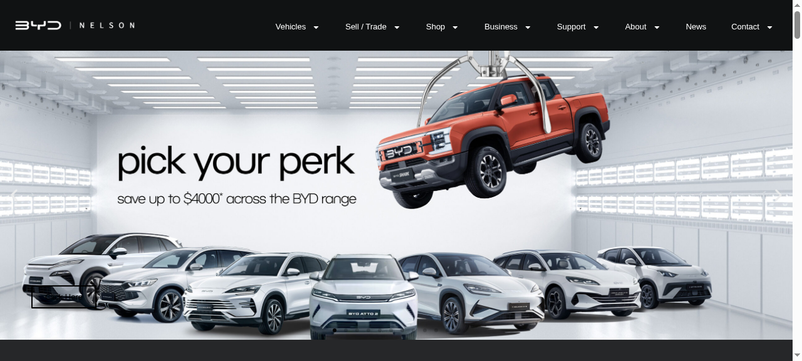

# BYD Nelson — EV Dealership Site

A full dealership website for a New Zealand electric-vehicle retailer: model range, live inventory, finance and trade-in pages, test-drive booking — plus an owner admin panel.

**[→ View the live site](https://byd-nelson.vercel.app/)**



## What this is

A dealership site where the inventory is the product. Visitors can browse the model range, filter live stock with photos and specs, read finance and trade-in terms, and book a test drive — all without phoning the yard.

The part that makes it useful day to day is the admin panel: the owner changes prices and stock himself, so the site never goes stale.

## What's inside

- Model range pages
- Live vehicle inventory with photos and specs
- Finance and trade-in pages
- Test-drive booking flow
- Owner admin panel for prices and stock
- Fully self-contained static build (40+ pages)

## Technology

- HTML, CSS and JavaScript
- Static front end with an admin layer
- Deployed on Vercel and GitHub Pages

## Run it locally

No build step, no dependencies — it's plain HTML, CSS and JavaScript.

```bash
# from the repository root
python3 -m http.server 8000
# then open http://localhost:8000
```

Or just open `index.html` directly in a browser.

## Note

This is a static build prepared for a dealership brand. All vehicle imagery, model names and brand marks belong to their respective owners; the code and layout are the work in this repository.


---

<sub>Built by **[Benito K Chukwuemeka](https://github.com/Ebubechineka)** · [Golden Vista Global](https://goldenvistaglobal.vercel.app/) — business websites, landing pages and web apps for clients in Nigeria and worldwide.</sub>
